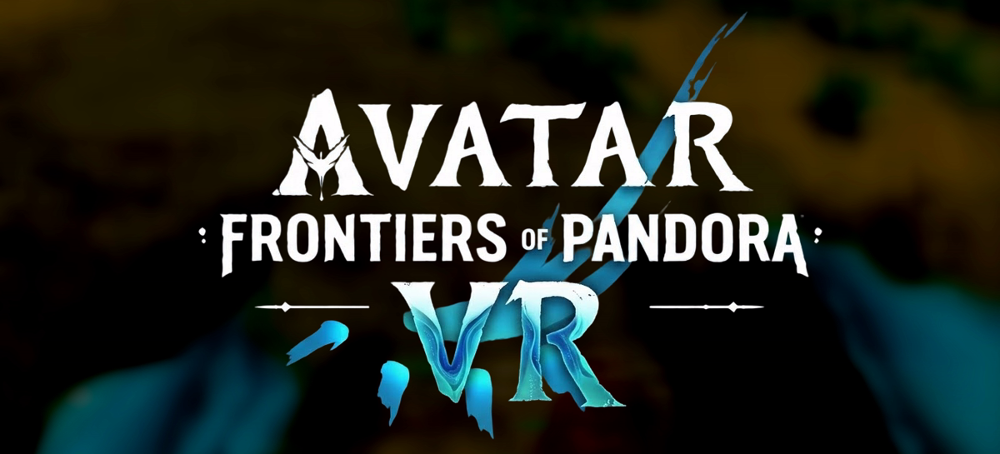
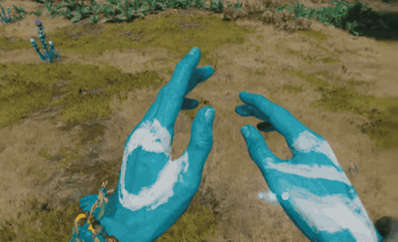
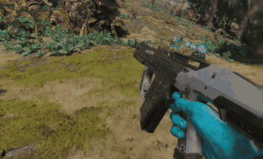
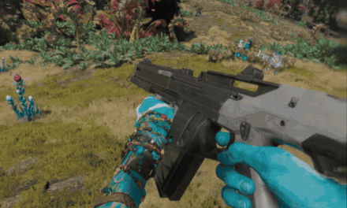
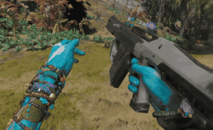
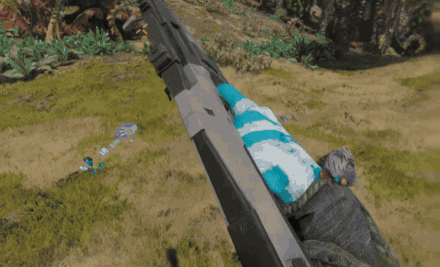
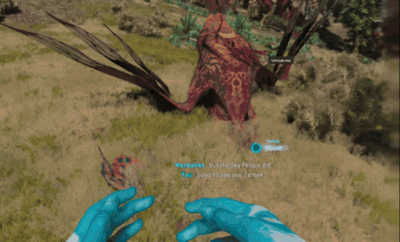

<p align="center">
  
</p>

<p align="center">
  A native stereo VR mod for <b>Avatar: Frontiers of Pandora</b> on PC.<br>
  Tracked hands, real weapon handling, first-person riding, and a lot of rough edges.
</p>

<p align="center">
  <a href="https://github.com/andyalpa/AvatarVR/releases/latest"><b>Download the latest test build</b></a> ·
  <a href="#getting-started">Install</a> ·
  <a href="docs/ROADMAP.md">Roadmap</a> ·
  <a href="CONTRIBUTING.md">Contributing</a>
</p>

---

AvatarVR is a playable work in progress. I've been building it for a while and it's at the point where other people should be able to try it, break it, and hopefully help fix it. I'm sharing the build and the source so anyone who wants to fix a bug, finish a feature, or take the mod in their own direction can pick up where I left off.

> [!WARNING]
> This is a test build. Expect bugs, visual artifacts and a heavy performance cost. Back up your saves and your `scripts` folder before installing.

## In the headset

<table>
  <tr>
    <td align="center"><br><sub>Tracked hands and finger gestures</sub></td>
    <td align="center"><br><sub>The gun sits in your hand and follows the controller</sub></td>
  </tr>
  <tr>
    <td align="center"><br><sub>Grab the front grip with your free hand</sub></td>
    <td align="center"><br><sub>Two-handed aiming</sub></td>
  </tr>
  <tr>
    <td align="center"><br><sub>Ammo and HUD widgets on your arm</sub></td>
    <td align="center"><br><sub>Getting close to your ikran</sub></td>
  </tr>
</table>

## What works

- **VR view and hands**: Native stereo renders both eyes each game frame. The headset tracks your head, the character's hands follow your controllers, and supported touch and button inputs drive finger gestures.
- **HUD and mounts**: You can attach supported HUD widgets to the character's arms or hands, or place them near your view. Mounting and riding can stay in first person. The flying controls and hand placement while riding still need work.
- **Weapons**: Either hand can aim. The crosshair follows the weapon's aim ray, and you can grab a gun with your free hand to aim with both hands. Visual recoil moves the gun and arms. Automatic-fire recoil can be inconsistent.
- **Bow and scanner**: On foot, grip the bowstring with your free hand, draw it back, and release to shoot. To use the X-ray scanner, bring your empty hand near your head and squeeze the grip.
- **Frame generation**: The mod has its own frame generation under **Headset → Frame generation (mod)**. OFXR also works as an OpenXR layer. Use one or the other, not both.

## Where it still needs work

Everything above could use more polish. Watch for right-eye artifacts, uneven lighting between the eyes, and a dark right eye after fast travel. HUD elements and the crosshair can shift, and hand tracking can get shaky while riding.

**Performance is the biggest limitation.** Native stereo is heavy, even on my RTX 4090. In my testing, getting a stable frame rate without frame generation was practically impossible. Frame generation makes head motion feel smoother, but busy scenes can still slow down.

## Unfinished features and ideas

- **Alternate Frame Warping (AFW)** was a prototype. I shelved it after headset tests showed wobble and shimmer.
- **Manual reload** is an in-progress rifle prototype. Magazine placement, animation timing, and the charging handle still need work. The regular reload button still works.
- **Visual holsters** for carrying gear on the body and over the shoulder. The shoulder gesture already works as a quick equip and stow shortcut.
- **World interactions**: using your hands with animals and plants, a healing gesture, and throwing grenades by hand.
- **A clearer VR menu, better flying controls**, and a proper harness grip for the ikran. There are more ideas in the [roadmap](docs/ROADMAP.md).

## Getting started

### Requirements

- Avatar: Frontiers of Pandora **1.0.2.2**, Windows x64 PC version
- A DirectX 12 GPU (a high-end one, see the performance notes above)
- A PC VR headset with a working OpenXR runtime (SteamVR, Virtual Desktop, Oculus, etc.)

### Install

1. Install the **Universal Snowdrop Modloader**. Put its `version.dll` and `version.ini` next to `afop.exe` and set `EnableScripts=true` in `version.ini`. [Loader download](https://github.com/patrickmollohan/Universal-Snowdrop-Modloader-Old/releases/download/USM-v1.0.0/version.zip)
2. Download `AvatarVR-win-x64.zip` from [Releases](https://github.com/andyalpa/AvatarVR/releases/latest) and copy `scripts/AvatarVR.dll` into the game's `scripts/` folder.
3. Start your OpenXR runtime and put the headset on before launching the game.
4. Run the game in windowed mode with DLSS on. Press **F10** and pick **Mod → Load working preset**, then load into gameplay. Use **Stereo → Recenter view** if forward feels off. If motion feels choppy, lower **View → Eye resolution scale** one step at a time.

To uninstall, delete `scripts/AvatarVR.dll`.

### Controls and tuning

- **Menu**: **F10** opens and closes the mod menu. Arrow keys and Enter select, Page Up and Page Down switch tabs. You can also point at it with your controllers. **F9** saves a stereo screenshot.
- **Hands and weapons**: In **Scripts**, keep **Script writes** and **Arm IK (controllers)** on. Use **Calibrate arms (T-pose)** if your reach feels off. Turn on **Empty-hand gestures** for finger inputs and use **Tuner → Fingers** to adjust poses. Set **Weapon hand** to Left or Right, aim with that controller and fire with its trigger. With **Two-hand aiming** on, squeeze your free hand's grip at the gun's front grip to steady or steer it. **Recoil strength** sets how much kick you see.
- **Bow and reload**: On foot, turn on **Bow string pull** and **Two-hand aiming**. Grip near the string with your free hand, draw back, and let go. While riding, use the regular trigger for the bow. With **VR controls** on, the upper face button on the gun hand reloads.
- **Scanner and shoulders**: Turn on **VR controls**. Squeeze the grip with an empty hand near your head to scan. A grip tap over a shoulder equips or stows gear. Holding it opens the weapon wheel.
- **HUD and riding**: Turn on **UI → Native HUD on arm**, then use **Tuner → HUD on arm** to pick an element and move it. Turn on **First-person mounts** under **Scripts** and use the normal mount and flight controls. **Arms follow controllers while mounted** keeps the tracked arms active while riding.

### If something goes wrong

- If the game stays flat, check that your OpenXR runtime sees the headset, then restart the game with the headset awake.
- Your settings are saved in `scripts/AvatarVR_settings.ini`. Back it up if you want to try fresh settings.
- When reporting a bug, please include what you were doing, your GPU, headset and OpenXR runtime, and `scripts/AvatarVR.log`. F9 screenshots are saved in `scripts/AvatarVR/captures/`.

## Building from source

### Tools

- **Visual Studio 2026** with the *Desktop development with C++* workload
- **CMake 4.2+** (the one that comes with Visual Studio is fine)
- **Git**
- Optional: **Python 3.11+** for the log tools and the arm tuner, **Lua 5.4** for the Lua tests

Everything else is in `third_party/`: MinHook, Dear ImGui, Lua 5.4 and the OpenXR SDK.

### Build

```powershell
git clone https://github.com/andyalpa/AvatarVR.git
cd AvatarVR
cmake -S . -B build -G "Visual Studio 18 2026" -A x64
cmake --build build --config Release --parallel
ctest --test-dir build -C Release --output-on-failure
```

The output goes to `build\bin\`: `AvatarVR.dll` (the mod), `load_proof_host.exe` (loads the DLL outside the game as a quick smoke test), and the `*_test.exe` unit tests.

### Build, install and launch in one step

Point the scripts at your game folder once per terminal, or set it as a user environment variable:

```powershell
$env:AFOP_GAME_ROOT = 'D:\Games\Avatar Frontiers of Pandora'
tools\run_cycle.bat
```

`run_cycle` builds the mod, runs the load test, copies `AvatarVR.dll` into `<game>\scripts\`, moves the previous logs into `<game>\scripts\runs\<time>\`, launches the game and waits for you to close it. Progress goes to `build\playtest\cycle_status.txt` and the full build log to `build\playtest\cycle_build.log`. It never touches `afop.exe`, `version.dll` or `version.ini`. The mod loader has to be installed already (see [Install](#install)).

`tools\pull_and_cycle.bat` does a `git pull` first, then the same cycle.

### Tests and releases

`ctest --test-dir build -C Release --output-on-failure` runs the standalone C++ tests and the DLL load check. `mv_repair_test.exe` and `scan_uv_shader_test.exe` need captured inputs; run them without arguments to see what they expect.

GitHub Actions runs the same build and tests on every push. Each successful run uploads a Windows x64 ZIP, and pushing a `v*` tag publishes that ZIP with its SHA-256 checksum to Releases. [docs/STATUS.md](docs/STATUS.md) lists the in-game checks that still need doing.

### Developer tools

| Tool | Use |
|---|---|
| `python tools\perf\runs_report.py <game>\scripts\runs` | Frame rate and frame time per play session |
| `python tools\perf\analyze_logs.py` | Summary of a session's renderer and CPU logs |
| `tools\ik_tuner\ik_tuner.bat` | Live arm IK tuning window (writes the tuning sections of `AvatarVR_settings.ini` while the game runs) |
| Lua scripting, F7 to reload | Try gameplay ideas in the running game. See [docs/SCRIPTING.md](docs/SCRIPTING.md). |

### Source layout

| Path | Contents |
|---|---|
| `src/dllmain.cpp` | Entry point: starts the hooks, menu and VR runtime |
| `src/camera/` | Second-eye rendering, per-eye camera and projection, UI placement, mounted camera |
| `src/dx12/` | Direct3D 12 / DXGI hooks (Present, queues, swapchain) |
| `src/vr/` | OpenXR session and frame submission, controller input, virtual gamepad, arms/IK, weapons, hand gestures |
| `src/ui/` | Mod menu (ImGui) and HUD panels |
| `src/game/` | Game-side hooks and state reads |
| `src/sdk/` | Engine names and addresses for game version 1.0.2.2 |
| `src/diagnostics/` | Capture tools and optional probes |
| `src/script/` | Embedded Lua host |
| `src/settings_file.hpp` | `AvatarVR_settings.ini` reader/writer |
| `tools/tests/` | C++ unit tests (each one is registered in `CMakeLists.txt`) |
| `tools/perf/` | Performance logging and analysis |
| `tools/ik_tuner/` | Arm tuning app |
| `lua/` | Shared Lua modules and offline tests |
| `third_party/` | Vendored libraries, each under its own license |

## Contributing

Pull requests are welcome. Read [CONTRIBUTING.md](CONTRIBUTING.md) first. The mod hooks a closed engine, so there are a few rules that keep things from crashing.

## Legal

This is an unofficial fan project. It isn't affiliated with or endorsed by Ubisoft, Massive Entertainment, Disney or Lightstorm. You need your own copy of the game. Don't commit game executables, assets or extracted game data to this repository.
